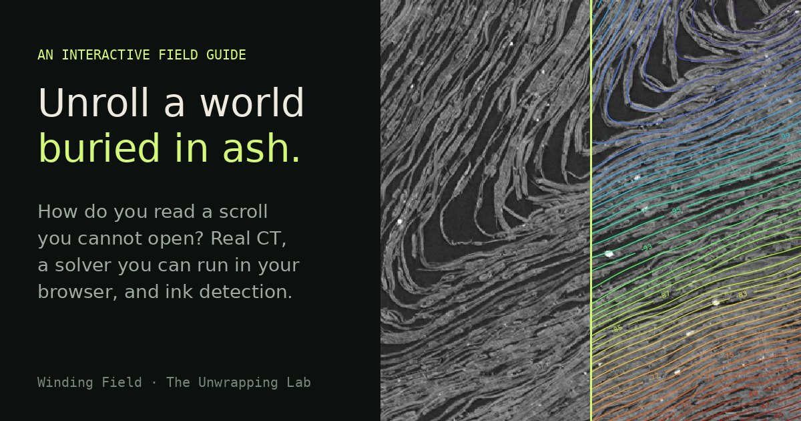

# winding-field-interactive-guide

[](https://github.com/LimeGS/winding-field-interactive-guide/actions/workflows/pages.yml)
[](LICENSE)

An interactive guide to reading a carbonized Herculaneum scroll without opening
it: real X-ray CT of PHerc. Paris 4, the winding-field method that turns local
predictions into pages you can unroll, and the ink detection that follows.
Hands-on experiments run in the browser; nothing to install.

Companion to [winding-field](https://github.com/LimeGS/winding-field),
[winding-field-cli](https://github.com/LimeGS/winding-field-cli) and
[ink-sdk](https://github.com/LimeGS/ink-sdk).

**Live site:** https://limegs.github.io/winding-field-interactive-guide/

[](https://limegs.github.io/winding-field-interactive-guide/)

## What's inside

| Chapter | Topic | Try it |
|---|---|---|
| Opening | Real PHerc. Paris 4 CT with the fitted winding field | Before/after slider |
| 01 The story | Herculaneum, 250 years of failed unrolling, CT scans, why tracing layers fails | Clue explorer |
| 02 The field | A coordinate W that counts turns of papyrus | Probe a coherent, drifting or collapsed field |
| 03 The solver | Weighted least squares, conjugate gradients, "converged ≠ correct" | Run a 72-node solver, inject a bad constraint |
| 04 The surface | Isosurfaces, marching cubes, flattening, validity masks | Unwrap a surface; real W = −60 result |
| 05 The ink | Surface volumes, labels, 3D stem + U-Net, pitfalls | Train a tiny ink detector |
| 06 The code | Real commands for geometry and ink at one 9.6 µm scale | Command builders |
| 07 Reference | Open problems, glossary, sources | — |

The guide reads like a book: 29 pages, each filling the screen. A bar at the
bottom carries Back, the chapter index with progress, and Next; scrolling and
the ← → keys also turn pages.

The PHerc. Paris 4 images are real winding-field output. Everything interactive
is a small teaching model; the command builders show real commands but do not
run them.

## Run locally

No build step or dependencies. Serve `dist/` over HTTP (ES modules do not load
from `file://`):

```bash
python3 -m http.server 8080 --directory dist
```

Then open http://localhost:8080. Any static host works: publish the contents of
`dist/` as they are. Pushes to `main` deploy to GitHub Pages through
[`.github/workflows/pages.yml`](.github/workflows/pages.yml).

## Layout

| Path | Contents |
|---|---|
| `dist/` | The site: `index.html`, CSS, ES modules, `examples/` configs |
| `dist/assets/real/` | Real PHerc. Paris 4 images (see credits) |
| `tests/` | Checks for the command builders and toy models |
| `docs/` | Design reviews, verification notes and screenshots |

## Checks

```bash
for t in tests/*.mjs; do node "$t"; done
```

`tests/mesh-ink-handoff.py` also checks the geometry-to-ink file handoff; it
needs winding-field-cli and ink-sdk checkouts and their dependencies
(see [docs/paris4-example.md](docs/paris4-example.md)).

Facts and commands were checked against winding-field `6dad095`,
winding-field-cli `59e1a10` and ink-sdk `81749a9`. The full source list is on
the site.

## Data and credits

- PHerc. Paris 4 CT: [Vesuvius Challenge](https://scrollprize.org/data), BM18
  scan `20260411134726`,
  [CC BY-NC 4.0](https://creativecommons.org/licenses/by-nc/4.0/). Fibre traces
  for the W = −60 surface: Bruniss (AFV v2). Images cropped from the
  [winding-field README](https://github.com/LimeGS/winding-field).
- Herculaneum photograph: Van Der Meulen Christofle, CC0.
- Papyrus fragment PHerc. 1103: Stabile et al. (2021), CC BY 4.0.

This is an independent guide by the authors of winding-field, winding-field-cli
and ink-sdk, not an official Vesuvius Challenge publication.

## License

[MIT](LICENSE) applies to repository-authored code. Images and data keep their
own licenses and terms, listed above.
